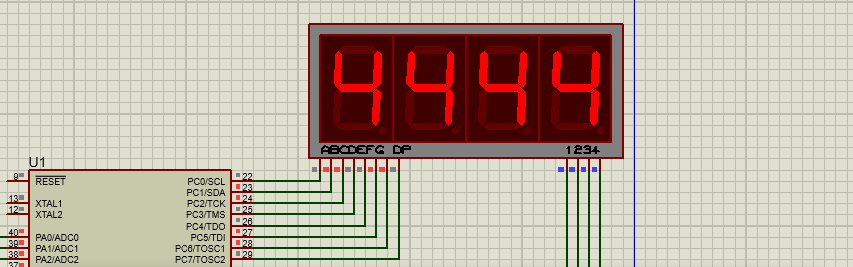

# AVR Microcontroller Laboratory — 10 Experiments in Embedded C (ATmega16/32)

Digital Systems Design Laboratory 2 (آزمایشگاه طراحی سیستم‌های دیجیتال ۲, based on the ATmega16/32) —
B.Sc. Electrical Engineering, Isfahan University of Technology, term 1401 (2022–2023).
Ten laboratory experiments in embedded C, each built in **CodeVisionAVR / Atmel Studio** and validated on the
schematic in **Proteus**.

**One-page overview (PDF): [`docs/project-overview.pdf`](docs/project-overview.pdf)** ·
**My submitted reports: [`exp01-io-port`](exp01-io-port) · [`exp03-lcd-and-keypad`](exp03-lcd-and-keypad) ·
[`exp05-motors`](exp05-motors) (Experiments 1, 3 and 5 only)**

---

## The ten experiments

| # | Folder | Topic | What I implemented |
|---|---|---|---|
| 1 | [`exp01-io-port`](exp01-io-port) | Digital I/O ports | `ioport.c` — reading switches and driving LEDs through the AVR port registers (six Proteus schematics, `Q1`…`Q6`) |
| 2 | [`exp02-seven-segment`](exp02-seven-segment) | 7-segment displays | `EXP2.c` plus a modular set of sources (`inputData.c`, `writeDataInOutput.c`, `Q3`–`Q5`) driving multiplexed 7-segment displays |
| 3 | [`exp03-lcd-and-keypad`](exp03-lcd-and-keypad) | Alphanumeric LCD + 4×4 keypad | `Exp3.c` with one module per question (`Q1`–`Q5`) — LCD initialisation and printing, keypad scanning and combined interaction |
| 4 | [`exp04-timers`](exp04-timers) | Timers and interrupts | `E4.c` and the `Q3` variant: timer configuration, precise delays and interrupt service routines |
| 5 | [`exp05-motors`](exp05-motors) | Motor drives | `exp5.c` plus `q2`–`q6`: DC/stepper motor control, direction and speed |
| 6 | [`exp06-adc`](exp06-adc) | ADC | `exp6.c` with `adcWithInt.c` and `adc_without_int.c` — the same conversion done by polling and by interrupt, comparing the two approaches |
| 7 | [`exp07-uart`](exp07-uart) | UART serial communication | `uartInit.c` + `Q1`, and the `Q2&3` module: UART setup, interrupt-driven reception/transmission and printing text on the LCD (`longTextLcd.c`) |
| 8 | [`exp08-graphic-lcd`](exp08-graphic-lcd) | Graphic LCD | `GLCD.c`, `pic.c` (bitmap rendering), `clock.c` and `dotMatrixFont.c` — drawing an image, a clock and a dot-matrix font on a 128×64 graphic LCD |
| 9 | [`exp09-spi`](exp09-spi) | SPI bus | Master/slave SPI communication between two AVRs with LCD output (folder names carry the group IDs of this exercise) |
| 10 | [`exp10-i2c-eeprom`](exp10-i2c-eeprom) | I²C (TWI) + EEPROM | I²C master (ATmega16) ↔ slave (ATmega32), plus read/write of a **24LC32 EEPROM**, with LCD and UART helpers |

## What each experiment folder contains

| Item | Example |
|---|---|
| Embedded C sources | `exp07-uart/codevision/Q2&3/exp7_Q2&3.c`, `.../source/uartInit.c` |
| Toolchain project files | `.cproj` / `.atsln` (Atmel Studio) and `.cwp` / `.prj` (CodeVisionAVR) |
| Proteus schematic | `exp04-timers/EXP4_rabbani/Proteus/timer.pdsprj` |
| Compiled firmware | the matching `.hex`, so the Proteus simulation can run without rebuilding |
| My report (Exps 1, 3, 5) | `exp01-io-port/Exp1_Rabbani/Exp1_Report/Exp1_Rabbani.pdf` |
| Proteus screen captures | `exp01-io-port/Exp1_Rabbani/Proteus/Q1.png` … `Q6.png`, `exp07-uart/EXP7_rabbani/Proteus/` |

### Proteus schematic and live simulation

*The I/O-port circuit running in Proteus: the ATmega16 drives the multiplexed 7-segment display.*

## How to open an experiment

1. **Code / firmware:** open the `.cproj` (Atmel Studio) or `.cwp` (CodeVisionAVR) project in the experiment folder;
   the `.c`/`.h` sources are next to it.
2. **Simulation:** open the `.pdsprj` in **Proteus** — the in-circuit AVR model is already loaded with the committed
   `.hex`, so the experiment runs without rebuilding.

> Left out of the repository on purpose: the professor's handouts (session PDFs and datasheets), the recorded lecture
> sessions, the original submission archives, the toolchain build trees (`Debug/`, `Release/`, object and symbol
> files) and the backup copies. Everything committed here is my own work: sources, project files, reports and the
> Proteus captures.

## Skills demonstrated

`Embedded C on 8-bit AVR (ATmega16/32)` · `register-level peripheral programming: GPIO, timers, ADC, UART, SPI, I²C/TWI`
· `interrupt-driven design and ISRs` · `display drivers (7-segment, alphanumeric LCD, 128×64 graphic LCD)` ·
`DC/stepper motor control` · `multi-microcontroller master/slave buses (SPI, I²C)` · `EEPROM interfacing` ·
`CodeVisionAVR / Atmel Studio toolchains` · `circuit simulation and validation in Proteus` ·
`bringing a peripheral up from its datasheet`

## Context and licence

Laboratory work for the Digital Systems Design Laboratory 2 course at Isfahan University of Technology
(term 1401, 2022–2023), carried out individually (except the SPI exercise, where the folder names carry the group
IDs). Published as a portfolio piece. Code released under the [MIT licence](LICENSE); the reports are
© Kiavash Rabbani Soudabi.
